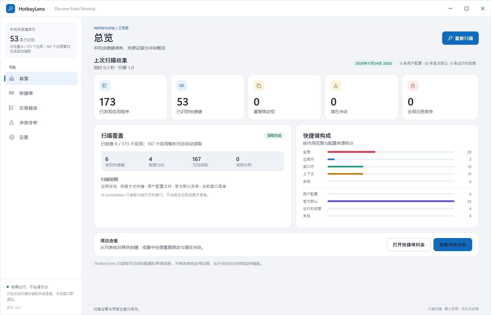
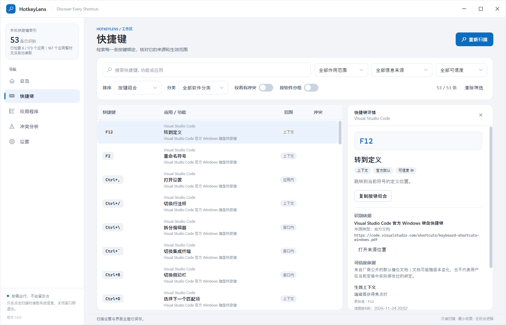
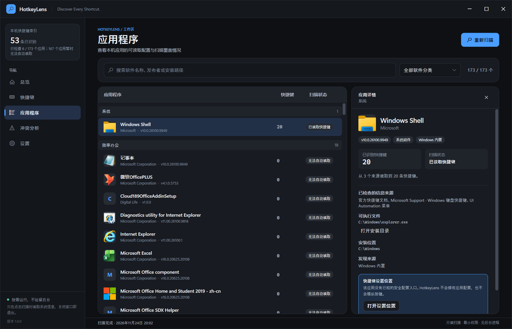
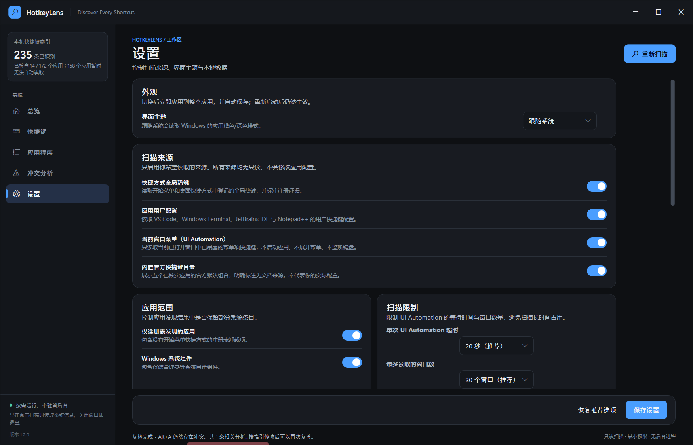

# HotkeyLens

> Discover Every Shortcut.

**English** | [简体中文](README.zh-CN.md)

HotkeyLens is an on-demand Windows desktop tool for discovering installed applications, reading accessible shortcut configurations, recording where every binding came from, and distinguishing proven global-hotkey competition, duplicate bindings, and potential conflicts.

It does not run in the background, does not continuously monitor the keyboard, and does not fabricate scan results. All scan data stays on your machine.



## Contents

- [Download and install](#download-and-install)
- [Project status](#project-status)
- [Core capabilities](#core-capabilities)
- [How shortcuts are read](#how-shortcuts-are-read)
- [Data model](#data-model)
- [Conflict analysis](#conflict-analysis)
- [Interface](#interface)
- [Architecture](#architecture)
- [Build and run](#build-and-run)
- [Data and privacy](#data-and-privacy)
- [Testing](#testing)
- [Known limitations](#known-limitations)
- [Security software and SmartScreen](#security-software-and-smartscreen)
- [Roadmap](#roadmap)
- [Documentation](#documentation)

## Download and install

**Most users should download a release package. A .NET runtime is not required.**

| Package | Best for | Size |
|---|---|---|
| `HotkeyLens-Setup.exe` | Normal installation with Start menu and optional desktop shortcuts | 43.6 MiB |
| `HotkeyLens-Portable-win-x64.zip` | Running without installation | 62.3 MiB |
| `SHA256SUMS.txt` | Verifying downloaded files | < 1 KiB |

Download them from the [latest GitHub release](https://github.com/mengzi0771/HotkeyLens/releases/latest).

### Install

1. Download `HotkeyLens-Setup.exe` and `SHA256SUMS.txt` from the same release.
2. Optionally verify the download:

   ```powershell
   Get-FileHash .\HotkeyLens-Setup.exe -Algorithm SHA256
   Get-Content .\SHA256SUMS.txt
   ```

   The hash must match `HotkeyLens-Setup.exe`.
3. Run the installer. It installs for the current user and does not require administrator rights.
4. Choose an installation folder and whether to create a desktop shortcut.
5. Launch HotkeyLens from the final page, the Start menu, or the desktop shortcut.

The executable is not code-signed. Windows SmartScreen may say "Unknown publisher". Only continue if the download came from this repository's release page and its hash matches. See [Security software and SmartScreen](#security-software-and-smartscreen).

### Portable

Extract `HotkeyLens-Portable-win-x64.zip` to a folder you control and run `HotkeyLens.exe`. The portable and installed builds share the same user data under `%LOCALAPPDATA%\HotkeyLens`; the ZIP itself does not contain scan data or source code.

### System requirements

- Windows 10 version 1809 or later, or Windows 11, x64
- A desktop session (the app is a WPF desktop program, not a service)
- No .NET SDK or .NET runtime installation

## Project status

- Platform: Windows 10 / Windows 11 (x64)
- Stack: C# / .NET 10 / WPF / Windows UI Automation
- Current version: 1.0.0
- Automated tests: 67 / 67 passing
- Status: builds, runs, and is packaged as a self-contained Windows x64 installation and portable build. Shortcut management is intentionally limited to safe, read-only navigation to an application's settings or configuration source; HotkeyLens does not rewrite third-party configurations.

## Core capabilities

### 1. Application discovery

Candidates are merged from several read-only sources:

- Windows uninstall entries (HKLM/HKCU, 64-bit and 32-bit views)
- `App Paths`
- Start Menu and desktop shortcuts
- Windows built-in Shell applications

Executables are deduplicated by normalized path; when no path is available, name and publisher are used instead. Runtimes, updaters, installers, and other non-application components are filtered out. A meaningful executable `FileDescription` takes priority over an ambiguous `ProductName`, preventing several Microsoft Office components from appearing under the same name.

Every discovered application keeps an explicit scan state: `Scanned`, `No shortcuts found`, `Not automatically readable`, or `Scan failed`. Finding no shortcuts never means the application has none, and both the UI and documentation say so explicitly.

### 2. Shortcut source adapters

The scan engine does not depend on any single application. Each source is an independent adapter behind one interface, returning bindings, scope, and diagnostics:

| Adapter | Input | Effective scope | Source type | Typical confidence |
|---|---|---|---|---|
| Shortcut hotkeys | `HotKey` field of Start Menu / desktop `.lnk` files | Global | User configuration | High |
| VS Code configuration | `keybindings.json` (VS Code / Insiders / VSCodium / Cursor) | Window / context | User configuration | High |
| Windows Terminal | `actions` and legacy `keybindings` in `settings.json` | Window / context | User configuration | High |
| JetBrains IDEs | Explicit `keyboard-shortcut` overrides in user keymap XML | Window | User configuration | High |
| Notepad++ | `%APPDATA%\Notepad++\shortcuts.xml` | Window | User configuration | High |
| Windows UI Automation | Accessible menu-item `AcceleratorKey` in open windows | Window | Runtime observation | Medium |
| Built-in official catalog | Bundled summaries of official shortcut documentation | As documented | Official defaults | Medium |

The built-in catalog currently covers VS Code, Windows Terminal, JetBrains IDEs, Notepad++ and Windows Shell. Every entry carries its official documentation URL. It represents documented defaults, not the user's current configuration.

Adapters only read files or properties exposed by UI Automation. They do not launch scanned applications, expand menus, install keyboard hooks, or modify other applications' settings.

### 3. Search and filtering

The Shortcuts page supports:

- Searching key gestures, application names, actions, descriptions, sources, confidence rationale, and raw values
- Filtering by application, application category, scope, source, confidence, and source type
- Showing only shortcuts involved in conflicts or duplicate groups
- Sorting by gesture, application, action, scope, confidence, or source
- Grouping by application
- Opening details and the original source location for an individual shortcut

Filtering is performed in memory by `ShortcutQuery` against the current snapshot; it does not re-read files or system state on each keystroke.

### 4. Conflict analysis

The same key combination does not automatically mean a conflict. HotkeyLens classifies findings by evidence:

| Type | Condition | Meaning |
|---|---|---|
| Global hotkey competition | Two or more applications declare a binding as global, and each has `.lnk` registration evidence | Multiple programs may try to register the same global hotkey |
| Potential conflict | At least one binding is global or has unknown scope | Interference is possible in some situations, but evidence is insufficient |
| Duplicate binding | Every participating binding is local to its own window or application | The applications can normally use the key independently |

Unknown scope lowers the conclusion; it is never presented as confirmed. Each result shows the participating applications, actions, scopes, rationale, confidence, and recommended handling.

## How shortcuts are read

HotkeyLens uses the following legitimate, read-only sources:

1. **Application discovery:** uninstall registry keys, `App Paths`, Start Menu and desktop shortcuts.
2. **Configuration files:** user configuration for known applications; read-only, never written back.
3. **Shortcut hotkeys:** the Shell Link header field, not simulated key presses.
4. **UI Automation:** only menu properties and `AcceleratorKey` exposed by currently open windows, bounded by a timeout and window limit.
5. **Official documentation catalog:** embedded default-shortcut summaries with their source URLs.

Windows has no public API for enumerating every global hotkey registered by other processes. HotkeyLens does not use `RegisterHotKey` for enumeration and does not use `WH_KEYBOARD_LL`. See [docs/LIMITATIONS.md](docs/LIMITATIONS.md) for the technical boundaries.

## Data model

Each `ShortcutEntry` records:

- A normalized gesture (`ShortcutGesture`) and, when applicable, the full key sequence
- Application, action name, and description
- Scope: global, application, window, contextual, or unknown
- Source type and source location
- Confidence and the rationale behind it
- Origin: official default, user configuration, runtime observation, or unknown
- Context, raw value, capture time, and enabled state

### Defaults vs. actual configuration

- `OfficialDefault`: read from official documentation. It may be a default and may vary by version.
- `UserConfigured`: read from an actual file or shortcut on this machine. It means "configured locally", not necessarily edited by hand.
- `RuntimeObserved`: observed from the current UI at scan time.
- `Unknown`: insufficient evidence; it is not forced into another category.

### Key sequences

A chord such as `Ctrl+K Ctrl+S` is stored as a full `KeySequence` while the first stroke, `Ctrl+K`, participates in ordinary gesture matching. A sequence is not treated as a single global hotkey, and it is excluded from conflict analysis.

## Conflict analysis

The analyzer only compares the same gesture across different applications. Multiple bindings inside one application are not treated as conflicting. Disabled entries and multi-stroke sequences are excluded. For each application, the entry with the strongest evidence is selected before scope and source determine the result type.

Results are evidence-based inferences, not registry facts. The UI explains the reasoning and never claims that a hotkey has definitively been "stolen".

## Interface

Five pages share one view model and scan snapshot:

- **Dashboard:** applications, shortcuts, duplicate groups, potential conflicts, global competition, last scan time, and coverage.
- **Shortcuts:** search, filters, sorting, grouping, list, and a detail panel.
- **Applications:** categories, icons, versions, scan state, paths, and settings locations.
- **Conflicts:** evidence and recommendations grouped by type, severity, and confidence.
- **Settings:** light/dark/system theme, scan-source toggles, timeout and window limits, data management, and about.

Themes are provided by shared resource dictionaries. Changing a theme applies immediately across the whole window and is saved automatically; no restart is required. The light theme uses a white sidebar, a light-gray workspace, and white cards. The dark theme uses neutral charcoal panels, dark-gray cards, and a single blue accent.

| Shortcuts (light) | Applications (dark) | Settings (dark) |
|---|---|---|
|  |  |  |

## Architecture

```
HotkeyLens.App (WPF/MVVM)
        |
        +-- Views / ViewModels / Themes
        +-- composition, single instance, lifecycle
                 |
                 v
HotkeyLens.Core
  Discovery -> ScanEngine -> Analysis -> Query
                  |
                  +-- Adapters (7 source types)
                  +-- Models / Catalog
                  +-- Persistence (JSON)
```

- **Core** owns models, application discovery, scan orchestration, source adapters, conflict analysis, querying, and persistence.
- **App** owns the WPF UI, MVVM, themes, window lifecycle, icon loading, and file-location actions.
- The scan engine depends only on `IApplicationDiscoveryService` and `IShortcutSourceAdapter`. Supporting a new application means adding an adapter, not changing the engine.
- Scanning runs asynchronously in the background with progress callbacks. Closing the window cancels scanning and releases the single-instance lock; no service or tray process remains.

See [docs/ARCHITECTURE.md](docs/ARCHITECTURE.md) for the full design.

## Build and run

### Build requirements

- Windows 10 or Windows 11 (x64)
- .NET SDK 10.0.400 or later (the repository pins `10.0.404`)
- Optional: the .NET desktop development workload in Visual Studio 2022/2026
- For installers: Inno Setup 6

```powershell
git clone https://github.com/mengzi0771/HotkeyLens.git
cd HotkeyLens
dotnet restore
dotnet build HotkeyLens.sln -c Release
dotnet run --project src/HotkeyLens.App/HotkeyLens.App.csproj -c Release
```

The framework-dependent development build is:

```
src/HotkeyLens.App/bin/Release/net10.0-windows/HotkeyLens.exe
```

It requires the .NET 10 Desktop Runtime on the target machine. This is not the build used by the downloadable release packages.

### Build release packages

```powershell
.\packaging\build-release.ps1 -Version 1.0.0
```

The script publishes a self-contained `win-x64` build, creates the portable ZIP, compiles the Inno Setup installer, and writes `SHA256SUMS.txt` under `artifacts\dist`. If Inno Setup is installed in a non-standard location, pass `-InnoCompiler <path-to-ISCC.exe>`.

The release workflow under `.github/workflows` runs the tests and builds the same assets. `.github/workflows/verify-installer.yml` can be started manually to install, upgrade, uninstall, and launch both packages on a clean GitHub Windows runner.

### Local data

Default data directory:

```
%LOCALAPPDATA%\HotkeyLens
├── scan-snapshot.json
└── preferences.json
```

For testing or diagnostics, override it with:

```powershell
$env:HOTKEYLENS_DATA_DIR = 'D:\HotkeyLens-data'
```

HotkeyLens never writes data into its installation directory or the registry. If security software blocks writes to the user profile, the UI reports the failure and leaves the existing snapshot untouched. Add HotkeyLens to the security software's trusted/allowed list instead of working around the protection by changing filenames.

## Data and privacy

- Scanning only happens after the user clicks Scan.
- No telemetry, no data upload, and no background network access.
- No reading of other process memory, no modification of other applications' settings, and no writes to the system registry.
- "Open source" and "Open settings location" use the system default handler only when the user clicks them.
- Closing the main window exits the application. There is no tray icon, startup task, or resident service.

## Testing

```powershell
dotnet test tests/HotkeyLens.Core.Tests/HotkeyLens.Core.Tests.csproj `
  --nologo -p:_MSTestEnableParentProcessQuery=false
```

Latest result:

```
Failed: 0, Passed: 67, Skipped: 0, Total: 67
```

Coverage includes gesture parsing, real application-discovery smoke tests, shortcut-header parsing, the built-in catalog, query filtering, conflict rules, scan-engine state transitions, snapshot/preference persistence, concurrent saves, and failed-save protection.

UI acceptance was performed with real scan data and Windows UI Automation, covering navigation across all five pages, search, details, theme switching, first scan, overwrite, failure protection, restart recovery, and clean exit. See [docs/TESTING.md](docs/TESTING.md) (Chinese).

## Known limitations

- Windows provides no API for enumerating every global hotkey registered by other processes.
- UI Automation can only see information exposed by currently open windows; HotkeyLens will not start applications or expand menus for scanning.
- Official documentation describes defaults, may change between versions, and does not reflect user configuration.
- The built-in catalog covers a small, verified set of applications. Uncovered applications are shown honestly as "Not automatically readable"; no synthetic data is produced.
- Configuration formats vary by version. Parse failures are recorded as diagnostics instead of being guessed.
- Shortcut management only locates settings or configuration sources. It does not automatically rewrite third-party configuration.
- On some machines, security software may block writes to the user profile. HotkeyLens preserves existing data and gives an actionable error instead of hiding the failure.
- Release binaries are not code-signed, so SmartScreen or "Unknown publisher" prompts may appear.

The complete list is in [docs/LIMITATIONS.md](docs/LIMITATIONS.md) (Chinese).

## Security software and SmartScreen

HotkeyLens writes its own settings and scan snapshots under `%LOCALAPPDATA%\HotkeyLens`. Some application-control products may silently deny that path to a newly downloaded, unsigned executable. The app then:

- reports the exact path and underlying error,
- keeps the previous `scan-snapshot.json` intact,
- removes only its own temporary file, and
- does not claim that the scan was saved.

If this happens, add `HotkeyLens.exe` (and, for installation, `HotkeyLens-Setup.exe`) to the security product's trusted/application list. Do not disable system-wide protection just to run HotkeyLens. No compatibility with every antivirus product is claimed or tested; the release has no digital signature, so Windows may show an "Unknown publisher" warning. Verify the SHA256 hash from the same release before running either package.

## Roadmap

- Add more verified application adapters (browsers, communication tools, design tools), each with official sources and tests.
- Add rollback-capable configuration editing for applications that explicitly support it, with automatic backups.
- Link conflict analysis with live window verification while keeping the evidence-first principle.
- Improve UI Automation coverage by letting the user choose a target window before scanning its menu hierarchy.
- Export shortcut inventories as CSV/JSON for team review.

## Documentation

- [Architecture](docs/ARCHITECTURE.md) (Chinese)
- [Technical limitations](docs/LIMITATIONS.md) (Chinese)
- [Testing](docs/TESTING.md) (Chinese)
- [Screenshot directory](docs/screenshots)
- [简体中文 README](README.zh-CN.md)

HotkeyLens follows one rule: **show what can be proven, and label clearly what cannot.**