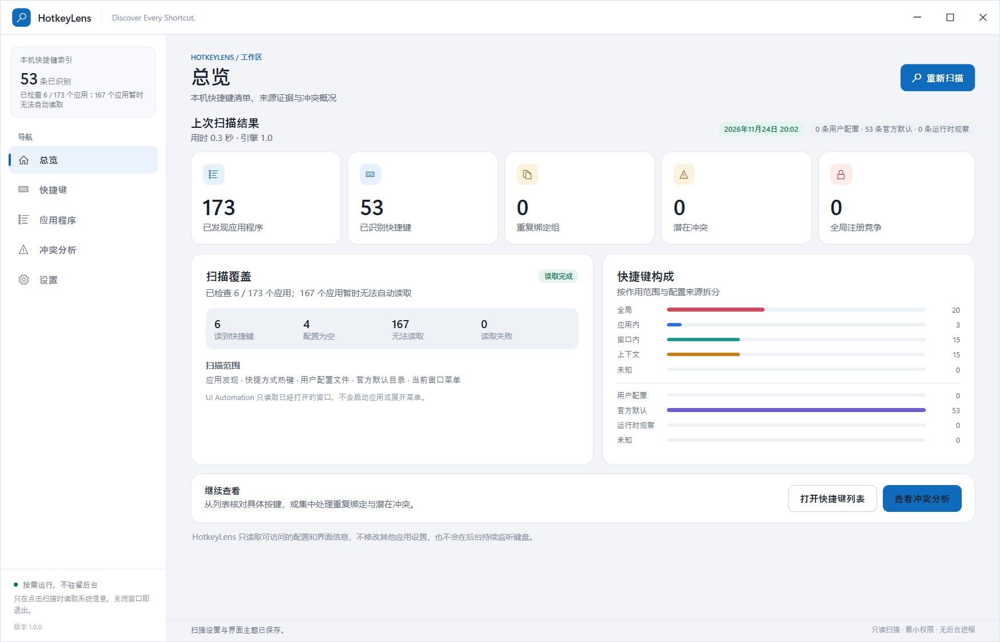
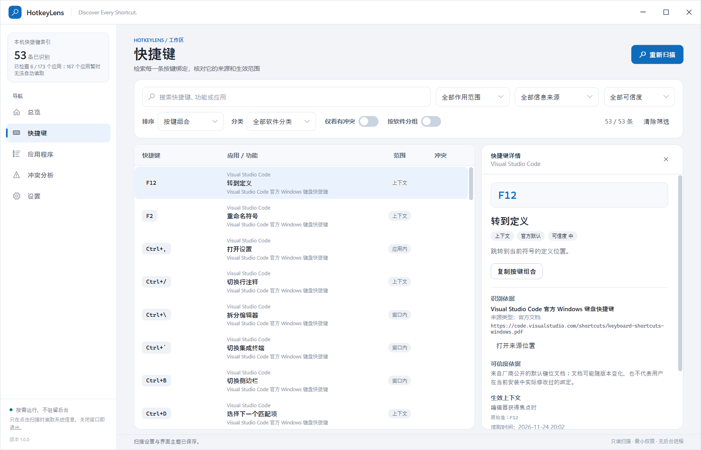
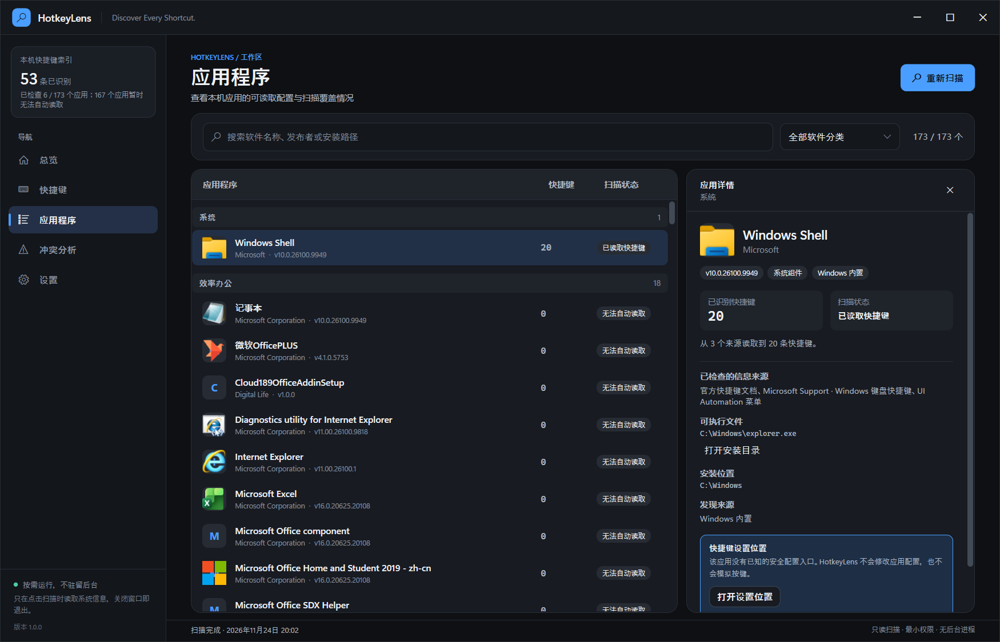
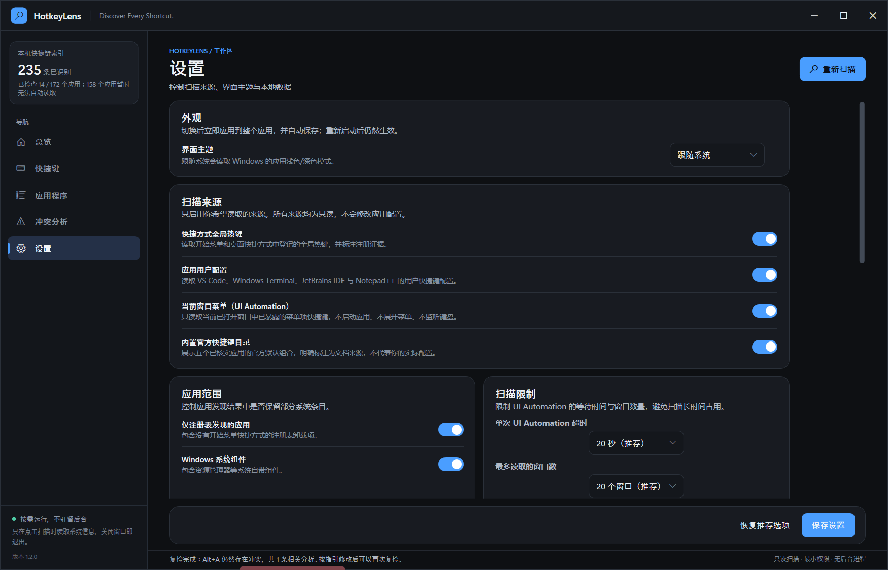

# HotkeyLens

> Discover Every Shortcut.

[English](README.md) | **简体中文**

HotkeyLens 是一款按需运行的 Windows 桌面工具，用于发现本机应用、读取可访问的快捷键配置、记录每条记录的来源与可信度，并区分真实的全局快捷键竞争、重复绑定和潜在冲突。

它不会在后台常驻，不会持续监听键盘，也不会伪造扫描结果。所有扫描结果只保存在本机。



## 目录

- [下载与安装](#下载与安装)
- [项目状态](#项目状态)
- [核心能力](#核心能力)
- [如何读取快捷键](#如何读取快捷键)
- [数据模型](#数据模型)
- [冲突分析](#冲突分析)
- [界面](#界面)
- [技术架构](#技术架构)
- [构建与运行](#构建与运行)
- [数据与隐私](#数据与隐私)
- [测试](#测试)
- [已知限制](#已知限制)
- [安全软件与 SmartScreen](#安全软件与-smartscreen)
- [后续方向](#后续方向)
- [文档](#文档)

## 下载与安装

**普通用户直接下载发行包即可，不需要单独安装 .NET 运行时。**

| 文件 | 适用场景 | 大小 |
|---|---|---|
| `HotkeyLens-Setup.exe` | 常规安装，创建开始菜单和可选桌面快捷方式 | 43.6 MiB |
| `HotkeyLens-Portable-win-x64.zip` | 免安装直接运行 | 62.3 MiB |
| `SHA256SUMS.txt` | 校验下载文件 | < 1 KiB |

请从 [GitHub 最新发行版](https://github.com/mengzi0771/HotkeyLens/releases/latest) 下载。

### 安装版

1. 从同一个发行版下载 `HotkeyLens-Setup.exe` 和 `SHA256SUMS.txt`。
2. 可选择先校验文件：

   ```powershell
   Get-FileHash .\HotkeyLens-Setup.exe -Algorithm SHA256
   Get-Content .\SHA256SUMS.txt
   ```

   计算的哈希必须与 `HotkeyLens-Setup.exe` 对应行一致。
3. 运行安装程序。它安装到当前用户，不要求管理员权限。
4. 选择安装目录，以及是否创建桌面快捷方式。
5. 可从安装完成页、开始菜单或桌面快捷方式启动 HotkeyLens。

程序没有代码签名，Windows SmartScreen 可能显示“未知发布者”。只有在你确认文件来自本仓库发行页且 SHA256 一致时才继续。参见 [安全软件与 SmartScreen](#安全软件与-smartscreen)。

### 便携版

将 `HotkeyLens-Portable-win-x64.zip` 解压到你有权控制的目录，直接运行 `HotkeyLens.exe`。便携版与安装版共用 `%LOCALAPPDATA%\HotkeyLens` 下的用户数据；ZIP 内不包含扫描数据或源代码。

### 系统要求

- Windows 10 1809 或更高版本，或 Windows 11，x64
- 桌面会话（这是 WPF 桌面程序，不是系统服务）
- 无需 .NET SDK 或 .NET 运行时

## 项目状态

- 平台：Windows 10 / Windows 11（x64）
- 技术栈：C# / .NET 10 / WPF / Windows UI Automation
- 当前版本：1.0.0
- 自动化测试：67 / 67 通过
- 当前状态：已打包为自包含 Windows x64 安装版和便携版；快捷键管理仅提供安全的只读定位，不自动改写第三方配置

## 核心能力

### 1. 应用程序发现

从多个只读数据源合并候选应用：

- Windows 卸载信息（HKLM/HKCU，64 位和 32 位视图）
- `App Paths`
- 开始菜单与桌面快捷方式
- Windows 内置 Shell 应用

合并时优先按规范化后的可执行文件路径去重；没有路径时再按名称和发布者判断。运行时、更新器、安装器等非应用组件会被排除。可执行文件的 `FileDescription` 优先于含义模糊的 `ProductName`，避免多个 Microsoft Office 组件显示成同一个名字。

界面对每个应用保留扫描状态：`已扫描`、`未发现快捷键`、`无法自动读取`、`扫描失败`。没有读取到快捷键不等于该应用没有快捷键，界面和文档都会明确这一点。

### 2. 快捷键来源适配器

扫描引擎不依赖任何单一软件。每种来源实现为独立的适配器，通过统一接口返回快捷键、覆盖范围和诊断信息：

| 适配器 | 读取对象 | 识别范围 | 来源类型 | 典型可信度 |
|---|---|---|---|---|
| 快捷方式热键 | 开始菜单/桌面 `.lnk` 的 `HotKey` 字段 | 全局 | 实际配置 | 高 |
| VS Code 配置 | `keybindings.json`（VS Code / Insiders / VSCodium / Cursor） | 窗口/上下文 | 实际配置 | 高 |
| Windows Terminal | `settings.json` 的 `actions` 与旧版 `keybindings` | 窗口/上下文 | 实际配置 | 高 |
| JetBrains IDE | 用户 keymap XML 中显式覆盖的 `keyboard-shortcut` | 窗口 | 实际配置 | 高 |
| Notepad++ | `%APPDATA%\Notepad++\shortcuts.xml` | 窗口 | 实际配置 | 高 |
| Windows UI Automation | 当前已打开窗口的菜单项 `AcceleratorKey` | 窗口 | 运行时观察 | 中 |
| 内置官方目录 | 随程序打包的官方快捷键文档摘要 | 文档声明的范围 | 官方默认 | 中 |

内置官方目录当前覆盖 VS Code、Windows Terminal、JetBrains IDE、Notepad++ 和 Windows Shell。条目附带官方文档 URL；它表示“官方默认值”，不代表用户当前实际配置。

适配器只会读取文件或 UI Automation 暴露的属性，不启动被扫描的应用，不展开菜单，不安装键盘钩子，不修改其他应用配置。

### 3. 搜索与筛选

快捷键页面支持：

- 搜索按键组合、应用名、功能、描述、来源、可信度依据和原始值
- 按应用、应用分类、作用范围、来源、可信度、来源类型筛选
- 只查看涉及冲突/重复的条目
- 按组合、应用、功能、范围、可信度或来源排序
- 按应用程序分组
- 打开单条快捷键的详情与来源位置

搜索结果由 `ShortcutQuery` 在内存中计算，使用当前快照，不重复访问磁盘或系统。

### 4. 冲突分析

相同按键组合并不自动等于冲突。HotkeyLens 按以下证据规则分类：

| 类型 | 判定条件 | 含义 |
|---|---|---|
| 全局快捷键竞争 | 两个及以上应用都声明为全局，且都有 `.lnk` 热键注册证据 | 多个程序可能尝试注册同一个全局热键 |
| 潜在冲突 | 至少一个绑定是全局或作用范围未知 | 某些场景下可能互相干扰，但证据不足 |
| 重复绑定 | 所有涉及绑定都位于各自窗口/应用内部 | 各应用内可独立使用，通常不构成实际冲突 |

作用范围未知时会降低结论等级，不会把未知包装成已确认。每条冲突显示参与应用、功能、范围、判断依据、可信度和建议处理方式。

## 如何读取快捷键

HotkeyLens 使用以下合法、只读的静态来源：

1. **应用发现**：注册表卸载项、`App Paths`、开始菜单和桌面快捷方式。
2. **配置读取**：解析已知应用的用户配置；只读，不写回。
3. **快捷方式热键**：读取 `.lnk` 的 Shell Link 头字段，而不是模拟按键。
4. **UI Automation**：只检查当前已打开窗口可访问的菜单属性和 `AcceleratorKey`，受超时和窗口数量限制。
5. **官方文档目录**：随程序嵌入、带来源 URL 的默认快捷键摘要。

Windows 没有公开 API 可以枚举其他进程已注册的全部全局快捷键。HotkeyLens 不通过 `RegisterHotKey` 枚举，也不使用 `WH_KEYBOARD_LL`。详见 [docs/LIMITATIONS.md](docs/LIMITATIONS.md)。

## 数据模型

每条 `ShortcutEntry` 至少包含：

- 规范化按键组合（`ShortcutGesture`），以及可选的完整按键序列
- 所属应用与功能名称、描述
- 作用范围：全局、应用内、窗口内、上下文相关、未知
- 来源类型与来源位置
- 可信度与判断理由
- 来源身份：官方默认、实际配置、运行时观察、未知
- 上下文、原始值、扫描时间、是否生效

### 明确区分“默认值”和“实际配置”

- `OfficialDefault`：来自官方文档，可能是默认值，也可能随版本变化。
- `UserConfigured`：从本机实际配置文件或快捷方式中读到；表示“本机已配置”，不保证由用户手工编辑。
- `RuntimeObserved`：扫描时从当前 UI 观察到。
- `Unknown`：来源不足，不强行归类。

### 按键序列

`Ctrl+K Ctrl+S` 这样的组合会保存为完整序列 `KeySequence`，同时用首段 `Ctrl+K` 参与普通按键匹配。序列不会被当作一次按键的全局热键，也不会直接参与冲突判定。

## 冲突分析

分析器只比较不同应用之间的同一按键组合，不会把同一应用内的多个绑定误判为互相冲突。禁用条目和多段序列会被排除。每个应用先选出最有证据的代表条目，再根据作用范围和来源得出冲突类型。

冲突结果不是系统级注册表事实，而是基于可读证据的推断；界面会说明依据，不会承诺“已确认某个热键被抢占”。

## 界面

五个页面共享同一套视图模型和扫描快照：

- **总览**：应用数、快捷键数、重复组、潜在冲突、全局竞争、扫描时间和覆盖情况。
- **快捷键**：搜索、筛选、排序、分组、列表和详情面板。
- **应用程序**：应用分类、图标、版本、状态、路径和设置位置。
- **冲突分析**：按冲突类型、严重度和可信度展示依据与建议。
- **设置**：浅色/深色/跟随系统、扫描来源开关、超时与窗口上限、数据管理和关于。

主题由统一的资源字典提供。切换主题会立即应用并自动保存，不需要重启。浅色主题使用白色侧栏、浅灰工作区和白色卡片；深色主题使用中性炭黑、深灰卡片和单一蓝色强调。

| 快捷键（浅色） | 应用程序（深色） | 设置（深色） |
|---|---|---|
|  |  |  |

## 技术架构

```
HotkeyLens.App (WPF/MVVM)
        │
        ├── Views / ViewModels / Themes
        └── App 装配、单实例、生命周期
                 │
                 ▼
HotkeyLens.Core
  Discovery → ScanEngine → Analysis → Query
                  │
                  ├── Adapters (7 类来源)
                  ├── Models / Catalog
                  └── Persistence (JSON)
```

- **Core** 负责模型、应用发现、扫描协调、来源适配器、冲突分析、查询和持久化。
- **App** 负责 WPF 界面、MVVM、主题、窗口生命周期、图标加载和文件定位。
- 扫描引擎只依赖 `IApplicationDiscoveryService` 与 `IShortcutSourceAdapter`；新增软件支持只需增加适配器，不修改引擎。
- 扫描在后台异步执行，UI 通过进度回调更新；关闭窗口会取消扫描并释放单实例锁，不留下后台服务或托盘进程。

详细说明见 [docs/ARCHITECTURE.md](docs/ARCHITECTURE.md)。

## 构建与运行

### 开发环境

- Windows 10 或 Windows 11（x64）
- .NET SDK 10.0.400 或更高版本（项目固定 `10.0.404`）
- 可选：Visual Studio 2022/2026 的 .NET 桌面开发工作负载
- 制作安装包需要 Inno Setup 6

```powershell
git clone https://github.com/mengzi0771/HotkeyLens.git
cd HotkeyLens
dotnet restore
dotnet build HotkeyLens.sln -c Release
dotnet run --project src/HotkeyLens.App/HotkeyLens.App.csproj -c Release
```

框架依赖的开发版本位于：

```
src/HotkeyLens.App/bin/Release/net10.0-windows/HotkeyLens.exe
```

运行该开发版本需要 .NET 10 Desktop Runtime；它不是发行包中的自包含版本。

### 构建发行包

```powershell
.\packaging\build-release.ps1 -Version 1.0.0
```

脚本会发布自包含 `win-x64` 版本、生成便携 ZIP、编译 Inno Setup 安装器，并在 `artifacts\dist` 写入 `SHA256SUMS.txt`。如果 Inno Setup 安装在非默认位置，传入 `-InnoCompiler <ISCC.exe 路径>`。

`.github/workflows` 中的发布工作流会执行测试并构建相同资产；`.github/workflows/verify-installer.yml` 可在干净的 GitHub Windows Runner 上手动执行安装、覆盖升级、卸载和启动验证。

### 数据位置

默认数据目录：

```
%LOCALAPPDATA%\HotkeyLens
├── scan-snapshot.json
└── preferences.json
```

测试或诊断时可通过环境变量覆盖：

```powershell
$env:HOTKEYLENS_DATA_DIR = 'D:\HotkeyLens-data'
```

程序不会把数据写入安装目录或注册表。若安全软件阻止程序写入用户目录，界面会明确提示，且不会覆盖原有快照；请将 HotkeyLens 加入该安全软件的信任/放行列表，而不是依赖改名规避。

## 数据与隐私

- 扫描只发生在用户点击扫描后。
- 不采集遥测，不上传数据，不进行网络请求。
- 不读取其他进程内存，不修改其他应用配置，不写系统注册表。
- 详情页的“打开来源”“打开设置位置”只在用户点击时调用系统默认程序。
- 关闭主窗口即退出；没有托盘图标、开机启动或常驻服务。

## 测试

```powershell
dotnet test tests/HotkeyLens.Core.Tests/HotkeyLens.Core.Tests.csproj `
  --nologo -p:_MSTestEnableParentProcessQuery=false
```

最近一次结果：

```
失败: 0，通过: 67，已跳过: 0，总计: 67
```

测试覆盖按键解析、真实应用发现冒烟、快捷方式头解析、来源目录、查询筛选、冲突规则、扫描引擎状态机、快照/偏好持久化、并发保存和保存失败保护。

界面验收使用真实扫描数据和 Windows UI Automation 操作完成，覆盖五页导航、搜索、详情、主题切换、首次扫描、覆盖保存、失败保护、重启恢复和退出行为。详见 [docs/TESTING.md](docs/TESTING.md)。

## 已知限制

- Windows 不提供枚举其他进程全局热键的 API；无法披露系统里所有已注册的全局热键。
- UI Automation 只能看到当前打开窗口暴露的信息；不会为扫描启动应用或展开菜单。
- 官方文档只代表默认值，可能随软件版本变化，也不等于用户配置。
- 内置官方目录只覆盖少量软件；未覆盖的软件会显示为“无法自动读取”，不会生成虚假数据。
- 配置文件格式因版本而异；解析失败会记录诊断，不会猜测绑定。
- 快捷键管理只提供设置页/配置来源定位，不自动改写第三方配置。
- 当前机器上的保存路径可能被第三方安全软件拦截；程序会保留旧数据并给出可操作错误。
- 发行程序没有代码签名，可能出现 SmartScreen 或“未知发布者”提示。

完整清单见 [docs/LIMITATIONS.md](docs/LIMITATIONS.md)。

## 安全软件与 SmartScreen

HotkeyLens 只将自己的设置与扫描快照写入 `%LOCALAPPDATA%\HotkeyLens`。某些应用控制软件可能静默拒绝新下载的未签名程序写入该路径。此时程序会：

- 显示具体路径和底层错误；
- 保留原有的 `scan-snapshot.json` 不变；
- 只清理自己的临时文件；
- 不把保存失败报告为成功。

遇到此情况，请将 `HotkeyLens.exe`（安装时还包括 `HotkeyLens-Setup.exe`）加入安全软件的信任/应用放行列表。不要为了运行 HotkeyLens 而关闭全系统防护。本项目没有声称通过所有杀毒软件检测，发行文件也没有数字签名，因此 Windows 可能显示“未知发布者”。运行前请核对同一个发行版中的 SHA256。

## 后续方向

- 增加更多经过核实的应用适配器（例如浏览器、通讯软件、设计工具），每个适配器附带官方来源和测试。
- 为已确认支持的应用提供可回滚的配置编辑，并在修改前自动备份。
- 增加冲突分析与当前窗口的联动验证，但保持“证据优先”原则。
- 改进 UI Automation 的覆盖策略，支持用户明确选择目标窗口后扫描菜单层级。
- 导出快捷键清单为 CSV/JSON，便于团队审阅。

## 文档

- [架构说明](docs/ARCHITECTURE.md)
- [技术限制](docs/LIMITATIONS.md)
- [测试说明](docs/TESTING.md)
- [截图目录](docs/screenshots)

HotkeyLens 的核心原则是：**能证明的才展示，不能证明的明确标注。**